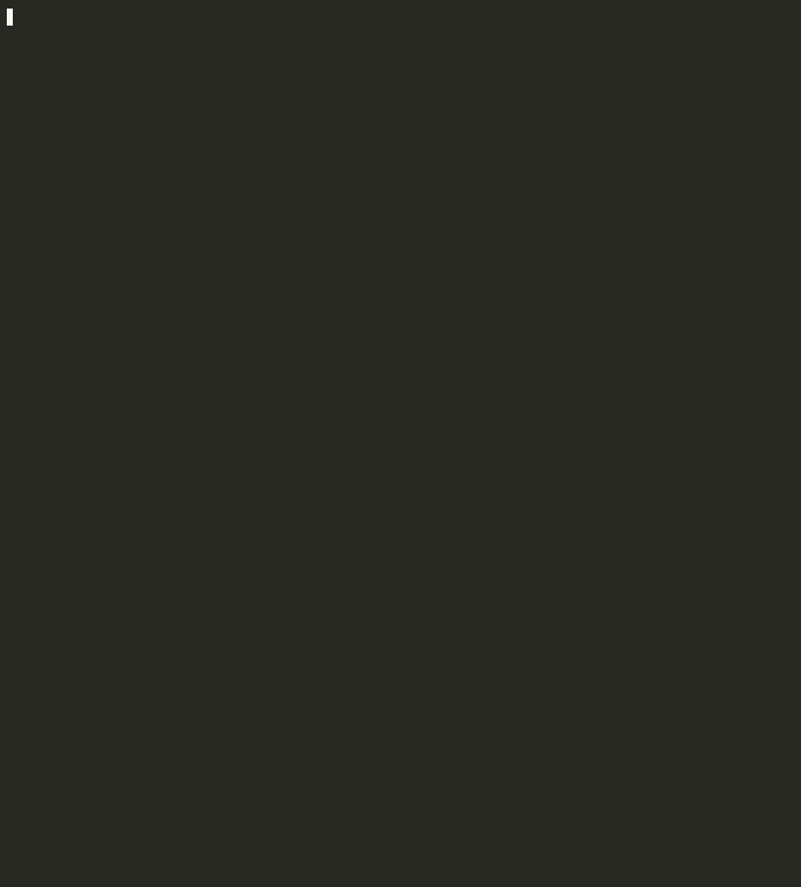

# DingDongDitch 🔔

> Knocks on every port, finds out who answers, and tells you which doors should never have been open.


[](https://pypi.org/project/dingdongditch/)


A port scanner written from scratch in Python. It finds open TCP ports, works out which service and version is behind each one, and proves common misconfigurations without exploiting anything.

**Status:** the scanner works, `update-db` downloads the vulnerability data and trains a model that predicts which CVEs attackers will use next better than CVSS and EPSS did ([results](#how-good-is-the-model)), and every scan lists each port's CVEs, worst first, with [why and how to fix them](#risk-levels).



<sub>A real scan of a lab VM, with the waiting sped up: it took about 50 seconds. The same output as text is just below.</sub>

## What it looks like

A real scan of a Metasploitable 2 lab VM:

```
$ dingdongditch scan 192.168.195.130 -p 21,139,1524 --karen-mode

                                 Open services
┌─────────────────┬──────────┬───────────┬───────────────────┬─────────────────┐
│ Host            │ Port     │ Service   │ Product / version │ Risk            │
├─────────────────┼──────────┼───────────┼───────────────────┼─────────────────┤
│ 192.168.195.130 │ 21/tcp   │ ftp       │ vsftpd 2.3.4      │ CONFIRMED       │
│                 │          │           │                   │ HIGH            │
│                 │          │           │                   │ 3 CVEs          │
│ 192.168.195.130 │ 139/tcp  │ smb       │ Samba smbd 3.0.20 │ KNOWN EXPLOITED │
│                 │          │           │                   │ 64 CVEs         │
│ 192.168.195.130 │ 1524/tcp │ bindshell │ bindshell         │ CONFIRMED       │
│                 │          │           │                   │ version unknown │
└─────────────────┴──────────┴───────────┴───────────────────┴─────────────────┘
OS guess for 192.168.195.130: Debian
  from port 139 (smb): Debian
CONFIRMED 192.168.195.130:21 Anonymous FTP login allowed
  Why: Anyone can log in to this FTP server without an account.
  Fix: Disable anonymous access, e.g. anonymous_enable=NO in vsftpd.conf.
CONFIRMED 192.168.195.130:1524 Open shell with no login
  Why: Anyone who connects gets a command prompt on this machine with no password. This is usually a backdoor.
  Fix: Find and stop whatever is listening on this port, and treat the machine as compromised until you know how it
got there.
HIGH 192.168.195.130:21 vsftpd 2.3.4: 3 known CVEs (1 HIGH, 2 LOW)
  CVE-2011-2523 HIGH (riskier than 99.8% of CVEs, CVSS 9.8, EPSS 96.2%)
    vsftpd 2.3.4 downloaded between 20110630 and 20110703 contains a backdoor which opens a shell on port 6200/...
    Why: no user action needed; public exploit on Exploit-DB; OS command injection (CWE-78)
    Fix: NVD lists no fixed release: check the vendor's advisories
  CVE-2021-3618 LOW (riskier than 82.5% of CVEs, CVSS 7.4, EPSS 2.0%)
    ALPACA is an application layer protocol content confusion attack, exploiting TLS servers implementing diffe...
    Why: no user action needed; affects debian_linux (debian); affects fedora (fedoraproject)
    Fix: upgrade to 3.0.4 or later
  CVE-2015-1419 LOW (riskier than 10.6% of CVEs, CVSS 5.0, EPSS 6.8%)
    Unspecified vulnerability in vsftpd 3.0.2 and earlier allows remote attackers to bypass access restrictions...
    Why: affects opensuse (opensuse); public for a long time; description says "bypass"
    Fix: upgrade to a release newer than 3.0.2
KNOWN EXPLOITED 192.168.195.130:139 Samba smbd 3.0.20: 64 known CVEs (1 KNOWN EXPLOITED, 7 HIGH, 5 MEDIUM, 51 LOW)
  CVE-2020-1472 KNOWN EXPLOITED (riskier than 100.0% of CVEs, CVSS 5.5, EPSS 99.4%)
    An elevation of privilege vulnerability exists when an attacker establishes a vulnerable Netlogon secure ch...
    Why: on CISA's list of CVEs used in real attacks; no user action needed; affects microsoft products; remote
    exploit on Exploit-DB
    Fix: upgrade to 4.10.18 or later
  CVE-2021-44142 HIGH (riskier than 99.2% of CVEs, CVSS 8.8, EPSS 73.6%)
    The Samba vfs_fruit module uses extended file attributes (EA, xattr) to provide "...enhanced compatibility...
    Why: no user action needed; affects enterprise_linux_for_power_big_endian (redhat); high CVSS score
    Fix: upgrade to 4.13.17 or later
  CVE-2020-25717 HIGH (riskier than 99.1% of CVEs, CVSS 8.1, EPSS 1.6%)
    A flaw was found in the way Samba maps domain users to local users
    Why: no user action needed; affects enterprise_linux_for_power_big_endian (redhat); affects debian_linux (debian)
    Fix: upgrade to 4.13.14 or later
  ...and 61 more: --json lists them all.
CVEs are matched on the version number alone. Linux distributions often patch a bug without changing it, so check the
installed package too.
```

## Install

You need Python 3.10 or newer. Install it with [pipx](https://pipx.pypa.io/), which gives it its own environment:

```bash
pipx install dingdongditch
```

`pipx upgrade dingdongditch` updates it. On Linux this also installs the manual:

```bash
man dingdongditch
```

Then download the vulnerability data and train the risk model, once (about 15 minutes the first time, a few minutes after that):

```bash
dingdongditch update-db
```

Scans work without it, but the Risk column says "no risk data".

XGBoost is optional, and only `train --xgboost` needs it:

```bash
pipx inject dingdongditch xgboost
```

nmap is optional too. You only need it for `--engine nmap`.

To try the newest code from GitHub instead of the last release:

```bash
pipx install git+https://github.com/Mamdouhelzein/dingdongditch.git
```

## Usage

Only scan machines you own or have written permission to test.

```bash
dingdongditch scan 192.168.195.130                  # default ports (about 1,100)
dingdongditch scan 192.168.195.130 -P quick         # about 100 common ports
dingdongditch scan 192.168.195.130 -P full          # all 65,535 ports
dingdongditch scan 192.168.195.130 -p 22,80,443     # exact ports
dingdongditch scan 192.168.195.130 -p 8000-9000     # a range
dingdongditch scan 10.0.0.1,10.0.0.2                # several hosts
dingdongditch scan 192.168.195.0/24 -P quick        # a whole subnet
dingdongditch scan 192.168.195.130 --karen-mode     # every port, every safe check
dingdongditch scan 192.168.195.130 --json           # JSON instead of a table
```

| Option | What it does | Default |
|---|---|---|
| `-P`, `--profile` | How many ports: `quick`, `default` or `full` | `default` |
| `-p`, `--ports` | Exact ports, such as `22,80` or `8000-9000` | |
| `--karen-mode` | All ports plus every extra check | off |
| `-t`, `--timeout` | Seconds to wait for each port | `1.0` |
| `-c`, `--concurrency` | Ports to try at once | `500` |
| `-e`, `--engine` | `own` (built in) or `nmap` | `own` |
| `-o`, `--save` | Also save the results to a file | |
| `--json` | Print JSON instead of a table | off |
| `--db` | The vulnerability database; the model is read from next to it | your user data folder |

Already have an nmap report? Read it the same way:

```bash
dingdongditch analyze scan.xml
nmap -sV -oX - 192.168.195.130 | dingdongditch analyze -
```

**Finding fewer ports than you expected?** It's probably going too fast for that machine or network. Slow it down with `-c 100 -t 3`.

## Vulnerability data

`update-db` downloads four free public sources into one local database file:

| Source | What it adds |
|---|---|
| [NVD](https://nvd.nist.gov/) | Every CVE: description, CVSS scores, weakness type, and the products and versions it affects |
| [CISA KEV](https://www.cisa.gov/known-exploited-vulnerabilities-catalog) | The CVEs attackers really exploited |
| [Exploit-DB](https://www.exploit-db.com/) | Which CVEs have public exploit code (only the index is downloaded, never the code) |
| [EPSS](https://www.first.org/epss/) | The daily chance that each CVE gets exploited in the next 30 days |

```bash
dingdongditch update-db                       # first run: 260 MB download, 10-15 minutes
dingdongditch update-db --full                # check every year of NVD data again
dingdongditch update-db --db ~/lab/vulns.db   # use another database file
dingdongditch update-db --epss-date 2025-05-01  # also keep EPSS as it was on that day
dingdongditch update-db --no-train            # don't retrain the risk model afterwards
```

Later runs only fetch what changed. If one source fails to download, it keeps its old data and the others still update. Then it retrains the [risk model](#risk-model) (about 2 minutes), so scans score each port with fresh data. The file is `vulns.db` in your user data folder (`~/.local/share/dingdongditch/` on Linux); set `DINGDONGDITCH_DB` or pass `--db` (to `scan` and `analyze` too) to keep it somewhere else.

`--epss-date` keeps EPSS scores from a past day (back to April 2021). Today's EPSS already knows which CVEs got exploited since then, so a fair test of the model compares it with EPSS from before.

## Risk model

`train` teaches a model which CVEs attackers really use, with CISA's list of exploited CVEs as the examples. It looks at the CVSS details, weakness type, vendor and product, description words, public exploits and age.

```bash
dingdongditch train                                 # about 2 minutes, saves model.joblib next to the database
dingdongditch train --xgboost                       # XGBoost instead: about 15 minutes, about as good
dingdongditch train --model ~/lab/model.joblib      # save it somewhere else
dingdongditch train --test 2025-05-01               # how it would have done from that day
```

`--xgboost` needs XGBoost, which isn't installed by default: add it with `pipx inject dingdongditch xgboost`.

`--test` is a fair time-travel test: it trains on only what was known that day, then checks how many of the CVEs CISA listed in the following year the model, CVSS and EPSS (as it was that day) would each have caught by fixing the top of their rankings. It saves nothing.

## Risk levels

After a scan, each service's product and version is looked up in NVD's lists of affected products. Every CVE found gets a level:

| Level | Meaning |
|---|---|
| `KNOWN EXPLOITED` | On CISA's list of CVEs used in real attacks |
| `HIGH` | The model ranks it in the top 1% of all CVEs, or Exploit-DB has a public remote exploit for it |
| `MEDIUM` | The model ranks it in the top 5% |
| `LOW` | Everything else |

The Risk column shows each port's worst level and how many CVEs it has. Below the table, each port lists its three worst CVEs:

- **riskier than X%:** the share of all CVEs the model ranks lower. Next to it are the CVSS score and today's EPSS, for reference.
- **Why:** the clues that raised the model's score most, such as "no login needed", "public exploit on Exploit-DB" or a weakness type.
- **Fix:** the first release NVD lists as fixed, or else the last one it lists as affected. Some CVEs have neither.

**The remote-exploit rule.** The model learns from CISA's list, which tracks current attack campaigns and rarely includes old CVEs (see [What to keep in mind](#how-good-is-the-model)). On its own it ranks Samba's 2007 `usermap_script` bug low, even though anyone can run that exploit against a server that was never patched. So a CVE with a public remote exploit on Exploit-DB is always at least `HIGH`, and its Why line says the rule raised it. The rule only ever raises a level.

The Risk column can also say:

| It says | Meaning |
|---|---|
| `no known CVEs` | NVD lists no CVE for this product and version |
| `version unknown` | The scan found no version, so there was nothing to look up. `--karen-mode` finds more, such as Samba, UnrealIRCd and Tomcat |
| `no risk data` | There's no database or model yet: run `dingdongditch update-db` |

With `--json`, each service gets a `risk` entry with its worst `level` and every CVE in `cves`: its level, `riskier_than` (0 to 1), whether it surely applies (`certain`), `fixed_in`, `last_affected`, CVSS, EPSS, a summary, the reasons, and the `rule` if one raised it.

**Limits**

- Matching uses the version number alone. Linux distributions often fix a bug without changing it, so check the installed package before you trust a match.
- Some NVD entries say "before 4.10.18" with no lower bound. That matches every older release too, even when the bug came later: Samba 3.0.20 gets Zerologon (CVE-2020-1472) this way.
- NVD files some CVEs about one vendor's package, such as a SUSE init script or the Windows installer for PostgreSQL, under the product itself, and their fix can be a package number like `9.4-0.5.3.1`.
- When the scan narrows a version down to a few releases, like PostgreSQL's "one of 8.3.0-8.3.7", a CVE that affects only some of them says "only some of the versions it could be".

## Karen mode

`--karen-mode` demands to speak to every port's manager.

| | Normal scan | Karen mode |
|---|---|---|
| Ports | Chosen by the profile | All 65,535, unless you use `-p` |
| Service and version | Banner plus one safe probe | More probes for ports it can't identify |
| IRC and SMB versions | | Read from a short visitor conversation |
| Web ports | Server header | Page title, headers and the app behind them |
| TLS ports | | Certificate details and problems |
| Operating system | | A guess, showing which port gave each clue |
| Misconfigurations | | Proved and marked `CONFIRMED` |

To read versions, Karen mode says hello to IRC servers as a visitor (it joins no channels) and opens an anonymous SMB session (no user, no password) to read the server's name, then leaves. If an IRC server says it's connecting too fast, it waits a minute and tries once more, so those scans take a little longer.

These checks do the smallest exchange that proves the problem, then leave. They never guess passwords or read data.

| Check | What it proves | How |
|---|---|---|
| `ftp-anonymous` | Anyone can log in to FTP | Logs in as the public `anonymous` user and quits |
| `open-shell` | A port hands out a command prompt | Recognises the prompt and never types into it |
| `redis-no-password` | Redis has no password | Reads the reply to the read-only `INFO server` |
| `mongodb-no-auth` | MongoDB has no login | Asks for databases matching a made-up name, so no real names come back |
| `telnet-open` | Telnet is running | Reads its greeting and doesn't log in |

## How it works

```
your targets  →  find open ports  →  ask each port what it is  →  match the answer to a product
              →  (Karen mode) web pages, certificates, OS guess, safe checks
              →  look up its CVEs  →  score and explain each one  →  report
```

1. **Port finder:** an async TCP connect scan with a worker pool. Ports that time out get a second, slower try, and it slows down by itself if the system runs out of sockets.
2. **Banner grabbing:** listens first, because many services speak first, then sends one harmless message. Ports that say nothing are asked once more a moment later, because a small machine can still be busy with the port scan. It tries TLS if plain text fails, and reads at most 4 KB. Services that only answer in their own protocol get one read-only question in it: DNS servers are asked their `version.bind`, and PostgreSQL gets a startup message for a protocol version that doesn't exist. It refuses before any login, and its error message shows which releases it could be.
3. **Fingerprints:** regex rules turn a banner into a product, version and CPE name.
4. **CVE matching:** the CPE's product and version are compared with NVD's affected versions and ranges. A patch like OpenSSH's `4.7p1` counts as `4.7`, and products NVD files under more than one vendor name (vsftpd, MySQL, ProFTPD, UnrealIRCd) are looked up under all of them.
5. **Scoring:** the model scores each CVE, and its biggest clues become the Why line.

## How good is it?

Tested against a real Metasploitable 2:

- A default scan found 24 open ports, and nmap's default top 1000 ports found 23. The two tools use different port lists.
- A full Karen mode scan from Kali found 30 open ports.
- Like nmap, it names BIND 9.4.2 and PostgreSQL 8.3 (one of 8.3.0 to 8.3.7) in every scan, and Samba 3.0.20 and UnrealIRCd 3.2.8.1 in Karen mode.
- In Karen mode, every service with a version gets its CVEs. BIND, Apache, Samba and Tomcat are `KNOWN EXPLOITED`; vsftpd, OpenSSH, ProFTPD, MySQL and UnrealIRCd are `HIGH`. The three famous backdoors are all `HIGH`: vsftpd's from the model alone (riskier than 99.8% of CVEs), Samba's `usermap_script` and UnrealIRCd's from the remote-exploit rule.

nmap still knows far more services, with thousands of probes. java-rmi, for example, is only named from its port number here.

Other limits:

- TCP only, so no UDP services yet.
- It makes full connections, which the target can log.
- The Redis and MongoDB checks have only been tested against local fake servers so far, not real ones.
- SMB versions need SMB1, which newer Windows and Samba turn off.
- Versions are what a service says about itself, and Linux distributions often patch old versions without changing the number.

## How good is the model?

The question: out of every CVE that is public today and not yet known to be exploited, which ones will attackers use next? The test goes back to a past day, ranks every such CVE using only what was known then, and checks which CVEs CISA added to its exploited list in the following year. A good ranking puts them near the top, so fixing its first few percent catches most of them.

These are the results of `dingdongditch train --test`. "Top 1%" means: of the CVEs CISA listed that year, the share you'd have caught by fixing the top 1% of the ranking. Random guessing catches about 1%, 5% and 10%.

**From 1 May 2025:** 275,380 CVEs ranked, 91 of them listed by CISA in the next year.

| Ranking | Top 1% | Top 5% | Top 10% | Average precision |
|---|---|---|---|---|
| CVSS | 1.6% | 14.6% | 31.1% | 0.0008 |
| Has a public exploit | 2.0% | 10.0% | 18.7% | 0.0004 |
| EPSS as it was that day | 27.5% | 52.7% | 58.2% | 0.0332 |
| **DingDongDitch** | **31.9%** | **54.9%** | **73.6%** | **0.0597** |

**From 1 May 2023:** 200,343 CVEs ranked, 53 of them listed by CISA in the next year.

| Ranking | Top 1% | Top 5% | Top 10% | Average precision |
|---|---|---|---|---|
| CVSS | 0.0% | 9.9% | 33.4% | 0.0007 |
| Has a public exploit | 2.5% | 12.6% | 25.3% | 0.0004 |
| EPSS as it was that day | 24.5% | 32.1% | 37.7% | 0.0122 |
| **DingDongDitch** | **34.0%** | **54.7%** | **77.4%** | **0.0218** |

In both years the model beats EPSS and leaves CVSS far behind. Sorting by CVSS barely beats random at the very top, because thousands of CVEs score 9.8 and most are never attacked.

What it learned makes sense. Products from Cisco, Ivanti, Microsoft, SonicWall and Citrix raise a score, and so do vendor notes like "exploited in the wild" or "Apple is aware of a report". CVEs NVD hasn't scored yet, and bug types like null-pointer crashes, lower it.

**How it was kept fair**

- Everything comes from before the day: the CVEs public by then, CISA's list as it stood, and Exploit-DB exploits published by then. EPSS is the score it gave that day, because today's EPSS already knows what happened next. Using it would roughly double EPSS's numbers.
- NVD references are left out. Links to news stories and exploits pile up *after* an attack, so they would leak the answer.
- The model's settings were chosen on a different year (May 2024 to May 2025, from standing on 1 May 2024), not on either test year.
- Being open about one choice: XGBoost and logistic regression tied across the two test years (XGBoost was a little better from 2025, logistic regression from 2023), and logistic regression became the default after seeing that. It's ten times faster, and each clue's weight can be read straight off it. `train --xgboost` gives the other one.
- CVSS is one set of clues for every CVE: the v3 score and vector where NVD has them, otherwise v2 translated into v3's terms. NVD only began v3 in 2016, and an earlier version that treated "no v3 score" as a clue learned that old CVEs are safe. The numbers above are from the current version.

**What to keep in mind**

- The test sets are small: 91 and 53 CVEs. One or two lucky catches move the top-1% number by a few points.
- CISA's list only holds exploitation CISA has confirmed, so some CVEs counted as "not exploited" really were. This makes every ranking look a little worse, the same for all of them.
- NVD keeps no history, so CVSS, descriptions and products are today's copies. They rarely change once a CVE is analysed. In the 2025 test, 10 of the 91 listed CVEs say "exploited in the wild" in their description. All 10 were published before the day, 8 of them in 2008–2013, when NVD descriptions routinely said so. Without them, the model still ties EPSS in the top 1% and 5% and beats it in the top 10% (70.4% against 55.6%).
- CISA's list rarely includes old CVEs. Of the CVEs from before 2012 that have a public remote exploit, 0.7% are on it, against 16.5% for CVEs since 2018. The model learns that, so it ranks an old CVE low even when it is dangerous on a server that never got patched.
- No model can rank a CVE before it is public. In the year after 1 May 2025, CISA listed 259 CVEs, and 168 of them were brand new (mostly zero-days). Those aren't in the test.

## Roadmap

- [x] **Part 1:** built-in scanner, Karen mode and safe checks
- [ ] Finish lab testing on Vulhub
- [x] **Part 2:** collect data from NVD, CISA KEV, Exploit-DB and EPSS (`dingdongditch update-db`)
- [x] **Part 3:** train a model on which CVEs really got exploited, and compare it with CVSS and EPSS (`dingdongditch train`)
- [x] **Part 4:** match services to CVEs and show a risk score per port, with why and how to fix it
- [x] **Part 5:** demo GIF and PyPI release (0.1.0)

Why a model? Knowing a service has CVEs is a database lookup. The hard part is prioritizing: an old OpenSSH can have dozens of CVEs, but only a few are ever exploited in the wild.

## Project layout

```
src/dingdongditch/
  cli.py           # the `dingdongditch` command
  targets.py       # IPs, hostnames, subnets → list of IPs
  ports.py         # port lists and profiles
  connect_scan.py  # finds open ports
  probes.py        # banner grabbing
  fingerprints.py  # banner → product, version, CPE
  http_info.py     # Karen mode: page title, headers, app
  tls_info.py      # Karen mode: certificates
  os_guess.py      # Karen mode: OS guess
  misconfig.py     # Karen mode: CONFIRMED checks
  binary_probes.py # DNS and PostgreSQL questions, and reading their answers
  conversations.py # Karen mode: IRC and SMB hellos that reveal versions
  mongo_wire.py    # just enough MongoDB protocol for its check
  own_scanner.py   # runs the steps above in order
  nmap_scanner.py  # the optional nmap engine
  nmap_parser.py   # nmap XML → services
  db.py            # the local vulnerability database (SQLite)
  collect.py       # downloads CISA KEV, EPSS and the Exploit-DB index
  nvd.py           # downloads NVD's CVE feeds, one CVE at a time
  features.py      # CVEs as they were on a date → numbers for the model
  train.py         # trains, saves and time-travel-tests the model
  evaluate.py      # top 1% / 5% / 10% and the CVSS and EPSS baselines
  versions.py      # compares version numbers the way NVD writes them
  matcher.py       # a scanned service → the CVEs NVD lists for it
  scorer.py        # levels, "riskier than", why and fix for each CVE
  data/            # PostgreSQL error line -> release table
docs/              # the demo GIF
man/               # the man page
scripts/           # rebuilds the PostgreSQL table from its source
tests/             # pytest, using fake local servers
```

## Development

```bash
git clone https://github.com/Mamdouhelzein/dingdongditch.git
cd dingdongditch
python -m venv .venv && source .venv/bin/activate
pip install -e ".[dev]"
ruff check .
pytest -q
```

## Legal and ethical use

DingDongDitch detects problems and never exploits them. Only scan systems you own or have **explicit written permission** to test, because scanning without authorization is illegal in many countries. For practice, use lab VMs like Metasploitable 2 on a private network.

## License

MIT © Mamdouh El Zein
