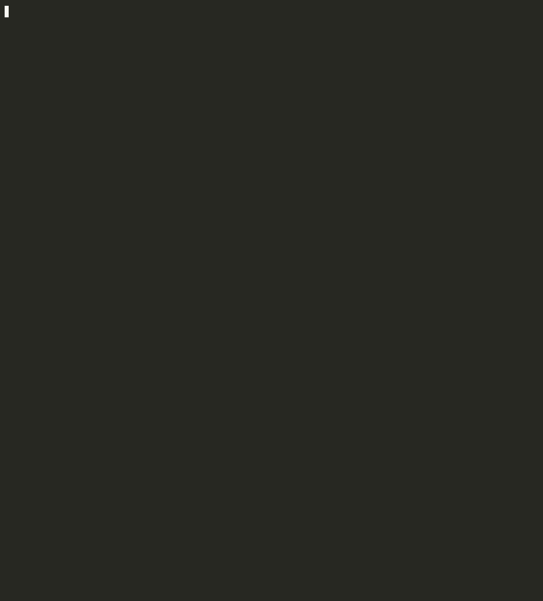

# DingDongDitch 🔔

> Knocks on every port, finds out who answers, and tells you which doors should never have been open.


[](https://pypi.org/project/dingdongditch/)


A port scanner written from scratch in Python. It finds open TCP ports, works out which service and version is behind each one, proves common misconfigurations without exploiting anything, and ranks each service's CVEs with a model trained on which CVEs attackers really used.

## What is shown, and what isn't yet

| | Result | How far to trust it |
|---|---|---|
| The model | In two time-travel tests, fixing the top 10% of its ranking caught 77% and 74% of the CVEs attackers used next. EPSS caught 38% and 58% ([results](#how-good-is-the-model)) | The top-10% lead in the 2023 test is too big to be luck. The top-1% leads are 4 and 5 CVEs, which luck can explain. Two test years so far |
| The scanner | On Metasploitable 2 a default scan found 24 open ports where nmap's found 23, and it names the same versions as nmap for BIND, PostgreSQL, Samba and UnrealIRCd ([details](#how-good-is-the-scanner)) | One lab machine. nmap knows far more services |
| CVE matching | Every service with a version gets its CVEs, split into sure and [possible](#sure-and-possible-matches) matches | Five known CVEs are in the [answer key](#how-good-is-the-matching) so far, so its precision isn't measured yet |



<sub>A real scan of a lab VM with release 0.1.0, with the waiting sped up: it took about 50 seconds.</sub>

> **This capture is from release 0.1.0, and its Samba row overstates.** `KNOWN EXPLOITED` comes from Zerologon (CVE-2020-1472), a 2020 bug in domain controllers. NVD lists it for every Samba before 4.10.18 and never says where it began, so Samba 3.0.20 from 2005 matches. The code on `main` now shows a match like that as [possible](#sure-and-possible-matches), and the row's level comes from its sure CVEs. A new capture will replace this one.

## Install

You need Python 3.10 or newer. Install it with [pipx](https://pipx.pypa.io/), which gives it its own environment:

```bash
pipx install dingdongditch
```

`pipx upgrade dingdongditch` updates it. On Linux this also installs the manual:

```bash
man dingdongditch
```

Then download the vulnerability data and train the risk model, once (about 15 minutes the first time, a few minutes after that):

```bash
dingdongditch update-db
```

Scans work without it, but the Risk column says "no risk data".

XGBoost is optional, and only `train --xgboost` needs it:

```bash
pipx inject dingdongditch xgboost
```

nmap is optional too. You only need it for `--engine nmap`.

Possible matches and the new `train --test` output are on `main` and not in a release yet. To try the newest code from GitHub instead of the last release:

```bash
pipx install git+https://github.com/Mamdouhelzein/dingdongditch.git
```

## Usage

Only scan machines you own or have written permission to test.

```bash
dingdongditch scan 192.168.195.130                  # default ports (about 1,100)
dingdongditch scan 192.168.195.130 -P quick         # about 100 common ports
dingdongditch scan 192.168.195.130 -P full          # all 65,535 ports
dingdongditch scan 192.168.195.130 -p 22,80,443     # exact ports
dingdongditch scan 192.168.195.130 -p 8000-9000     # a range
dingdongditch scan 10.0.0.1,10.0.0.2                # several hosts
dingdongditch scan 192.168.195.0/24 -P quick        # a whole subnet
dingdongditch scan 192.168.195.130 --karen-mode     # every port, every safe check
dingdongditch scan 192.168.195.130 --json           # JSON instead of a table
```

| Option | What it does | Default |
|---|---|---|
| `-P`, `--profile` | How many ports: `quick`, `default` or `full` | `default` |
| `-p`, `--ports` | Exact ports, such as `22,80` or `8000-9000` | |
| `--karen-mode` | All ports plus every extra check | off |
| `-t`, `--timeout` | Seconds to wait for each port | `1.0` |
| `-c`, `--concurrency` | Ports to try at once | `500` |
| `-e`, `--engine` | `own` (built in) or `nmap` | `own` |
| `-o`, `--save` | Also save the results to a file | |
| `--json` | Print JSON instead of a table | off |
| `--db` | The vulnerability database; the model is read from next to it | your user data folder |

Already have an nmap report? Read it the same way:

```bash
dingdongditch analyze scan.xml
nmap -sV -oX - 192.168.195.130 | dingdongditch analyze -
```

**Finding fewer ports than you expected?** It's probably going too fast for that machine or network. Slow it down with `-c 100 -t 3`.

## Vulnerability data

`update-db` downloads four free public sources into one local database file:

| Source | What it adds |
|---|---|
| [NVD](https://nvd.nist.gov/) | Every CVE: description, CVSS scores, weakness type, and the products and versions it affects |
| [CISA KEV](https://www.cisa.gov/known-exploited-vulnerabilities-catalog) | The CVEs attackers really exploited |
| [Exploit-DB](https://www.exploit-db.com/) | Which CVEs have public exploit code (only the index is downloaded, never the code) |
| [EPSS](https://www.first.org/epss/) | The daily chance that each CVE gets exploited in the next 30 days |

```bash
dingdongditch update-db                       # first run: 260 MB download, 10-15 minutes
dingdongditch update-db --full                # check every year of NVD data again
dingdongditch update-db --db ~/lab/vulns.db   # use another database file
dingdongditch update-db --epss-date 2025-05-01  # also keep EPSS as it was on that day
dingdongditch update-db --no-train            # don't retrain the risk model afterwards
```

Later runs only fetch what changed. If one source fails to download, it keeps its old data and the others still update. Then it retrains the [risk model](#risk-model) (about 2 minutes), so scans score each port with fresh data. The file is `vulns.db` in your user data folder (`~/.local/share/dingdongditch/` on Linux); set `DINGDONGDITCH_DB` or pass `--db` (to `scan` and `analyze` too) to keep it somewhere else.

`--epss-date` keeps EPSS scores from a past day (back to April 2021). Today's EPSS already knows which CVEs got exploited since then, so a fair test of the model compares it with EPSS from before.

## Risk model

`train` teaches a model which CVEs attackers really use, with CISA's list of exploited CVEs as the examples. It looks at the CVSS details, weakness type, vendor and product, description words, public exploits and age.

```bash
dingdongditch train                                 # about 2 minutes, saves model.joblib next to the database
dingdongditch train --xgboost                       # XGBoost instead: about 15 minutes, about as good
dingdongditch train --model ~/lab/model.joblib      # save it somewhere else
dingdongditch train --test 2025-05-01               # how it would have done from that day
dingdongditch train --test 2025-05-01 --tune        # the same, with settings chosen on the year before
```

`--xgboost` needs XGBoost, which isn't installed by default: add it with `pipx inject dingdongditch xgboost`.

`--test` is a time-travel test: it trains on only what was known that day, then checks how many of the CVEs CISA listed in the following year the model, CVSS and EPSS (as it was that day) would each have caught by fixing the top of their rankings. It saves nothing. Give it several days a year apart and it adds them up. [How good is the model?](#how-good-is-the-model) has the results.

## Risk levels

After a scan, each service's product and version is looked up in NVD's lists of affected products. Every CVE found gets a level:

| Level | Meaning |
|---|---|
| `KNOWN EXPLOITED` | On CISA's list of CVEs used in real attacks |
| `HIGH` | The model ranks it in the top 1% of all CVEs, or Exploit-DB has a public remote exploit for it |
| `MEDIUM` | The model ranks it in the top 5% |
| `LOW` | Everything else |

Below the table, each port lists its three worst sure CVEs:

- **riskier than X%:** the share of all CVEs the model ranks lower. Next to it are the CVSS score and today's EPSS, for reference.
- **Why:** the clues that raised the model's score most, such as "no login needed", "public exploit on Exploit-DB" or a weakness type.
- **Fix:** the first release NVD lists as fixed, or else the last one it lists as affected. Some CVEs have neither.

### Sure and possible matches

A CVE is a **sure** match when NVD names the scanned release, or a range of releases that starts somewhere ("from 3.0.0 up to 3.0.25"). It is only a **possible** match when NVD lists every release before the fix and never says where the bug began ("before 4.10.18"). Some of those are real, because an old bug is often filed that way. Some are doubtful: Samba 3.0.20, from 2005, matches Zerologon, a 2020 bug in domain controllers, like this.

So a port's level comes from its sure CVEs only. The Risk column then adds how many possible ones there are and their worst level, and below the table the worst possible CVE is shown apart, marked as possible. With `--json`, each CVE has `open_ended` (true for a possible match), and the port has `level` and `possible_level`.

**The remote-exploit rule.** The model learns from CISA's list, which tracks current attack campaigns and rarely includes old CVEs. On its own it ranks Samba's 2007 `usermap_script` bug low, even though anyone can run that exploit against a server that was never patched. So a CVE with a public remote exploit on Exploit-DB is always at least `HIGH`, and its Why line says the rule raised it. The rule only ever raises a level.

The Risk column can also say:

| It says | Meaning |
|---|---|
| `no known CVEs` | NVD lists no CVE for this product and version |
| `version unknown` | The scan found no version, so there was nothing to look up. `--karen-mode` finds more, such as Samba, UnrealIRCd and Tomcat |
| `no risk data` | There's no database or model yet: run `dingdongditch update-db` |

**Limits of matching**

- It uses the version number alone. Linux distributions often fix a bug without changing it, so check the installed package before you trust a match.
- NVD files some CVEs about one vendor's package, such as a SUSE init script or the Windows installer for PostgreSQL, under the product itself, and their fix can be a package number like `9.4-0.5.3.1`.
- When the scan narrows a version down to a few releases, like PostgreSQL's "one of 8.3.0-8.3.7", a CVE that affects only some of them says "only some of the versions it could be".

## Karen mode

`--karen-mode` demands to speak to every port's manager.

| | Normal scan | Karen mode |
|---|---|---|
| Ports | Chosen by the profile | All 65,535, unless you use `-p` |
| Service and version | Banner plus one safe probe | More probes for ports it can't identify |
| IRC and SMB versions | | Read from a short visitor conversation |
| Web ports | Server header | Page title, headers and the app behind them |
| TLS ports | | Certificate details and problems |
| Operating system | | A guess, showing which port gave each clue |
| Misconfigurations | | Proved and marked `CONFIRMED` |

To read versions, Karen mode says hello to IRC servers as a visitor (it joins no channels) and opens an anonymous SMB session (no user, no password) to read the server's name, then leaves. If an IRC server says it's connecting too fast, it waits a minute and tries once more, so those scans take a little longer.

These checks do the smallest exchange that proves the problem, then leave. They never guess passwords or read data.

| Check | What it proves | How |
|---|---|---|
| `ftp-anonymous` | Anyone can log in to FTP | Logs in as the public `anonymous` user and quits |
| `open-shell` | A port hands out a command prompt | Recognises the prompt and never types into it |
| `redis-no-password` | Redis has no password | Reads the reply to the read-only `INFO server` |
| `mongodb-no-auth` | MongoDB has no login | Asks for databases matching a made-up name, so no real names come back |
| `telnet-open` | Telnet is running | Reads its greeting and doesn't log in |

## Why not just use nmap?

For finding ports and naming services, nmap is the better tool: it has thousands of probes, and this scanner knows about 25 services. `--engine nmap` runs it for you, and `analyze` reads a report you already have.

The built-in scanner is there for three reasons:

- **Nothing else to install.** `pipx install dingdongditch` gives a working scan on a machine without nmap.
- **The `CONFIRMED` checks and Karen mode are built on it.** They need the conversation with each port, not just its name: the FTP login, the Redis reply, the IRC and SMB hellos.
- **I wrote it to learn how scanning works.** Connect scans, banner grabbing, protocol probes and version fingerprints are all here to read, in about 2,000 lines of Python.

What nmap doesn't do is the part after the scan. A service with 64 CVEs is a list, not an answer. Ranking those CVEs by how likely attackers are to use them, and checking that ranking against what happened next, is what this project is about.

## How good is the scanner?

Tested against a real Metasploitable 2, and only that so far:

- A default scan found 24 open ports, and nmap's default top 1000 ports found 23. The two tools use different port lists.
- A full Karen mode scan from Kali found 30 open ports.
- Like nmap, it names BIND 9.4.2 and PostgreSQL 8.3 (one of 8.3.0 to 8.3.7) in every scan, and Samba 3.0.20 and UnrealIRCd 3.2.8.1 in Karen mode.

Limits:

- nmap knows far more services. java-rmi, for example, is only named from its port number here.
- TCP only, so no UDP services yet.
- It makes full connections, which the target can log.
- The Redis and MongoDB checks have only been tested against local fake servers so far, not real ones.
- SMB versions need SMB1, which newer Windows and Samba turn off.
- Versions are what a service says about itself.

## How good is the matching?

Not measured yet, and this is how it will be. [`data/lab_truth.json`](https://github.com/Mamdouhelzein/dingdongditch/blob/main/data/lab_truth.json) is an answer key: lab services, and the CVEs known to affect their exact release. This checks the matcher against it:

```bash
python -m dingdongditch.lab_check data/lab_truth.json
```

It reports how many of the known CVEs the matcher calls sure, calls only possible, or misses, and how many of its sure matches the key says nothing about. The key starts with five Metasploitable 2 services and their famous CVEs, plus Zerologon as a match that must never be called sure. Every Vulhub lab is a product, a version and a CVE, so each one scanned adds a line.

With release 0.1.0, before sure and possible matches were split, a Karen mode scan of Metasploitable 2 gave every service with a version its CVEs: BIND, Apache, Samba and Tomcat came out `KNOWN EXPLOITED`, and vsftpd, OpenSSH, ProFTPD, MySQL and UnrealIRCd `HIGH`. Some of those levels came from possible matches, so they will be measured again.

## How good is the model?

The question: out of every CVE that is public today and not yet known to be exploited, which ones will attackers use next? The test goes back to a past day, ranks every such CVE using only what was known then, and checks which CVEs CISA added to its exploited list in the following year.

"Top 1%" means: of the CVEs CISA listed that year, the share you'd have caught by fixing the top 1% of the ranking. Random guessing catches about 1%, 5% and 10%. The numbers in brackets are CVEs caught.

**From 1 May 2025:** 275,380 CVEs ranked, 91 of them listed by CISA in the next year.

| Ranking | Top 1% | Top 5% | Top 10% | Average precision |
|---|---|---|---|---|
| CVSS | 1.6% | 14.6% | 31.1% | 0.0008 |
| Has a public exploit | 2.0% | 10.0% | 18.7% | 0.0004 |
| EPSS as it was that day | 27.5% (25) | 52.7% (48) | 58.2% (53) | 0.0332 |
| **DingDongDitch** | **31.9% (29)** | **54.9% (50)** | **73.6% (67)** | **0.0597** |

**From 1 May 2023:** 200,343 CVEs ranked, 53 of them listed by CISA in the next year.

| Ranking | Top 1% | Top 5% | Top 10% | Average precision |
|---|---|---|---|---|
| CVSS | 0.0% | 9.9% | 33.4% | 0.0007 |
| Has a public exploit | 2.5% | 12.6% | 25.3% | 0.0004 |
| EPSS as it was that day | 24.5% (13) | 32.1% (17) | 37.7% (20) | 0.0122 |
| **DingDongDitch** | **34.0% (18)** | **54.7% (29)** | **77.4% (41)** | **0.0218** |

**What these numbers do and don't show**

- **Far better than CVSS: yes.** Sorting by CVSS barely beats random at the top, because thousands of CVEs score 9.8 and most are never attacked.
- **Better than EPSS in the top 10%: yes for 2023.** 41 against 20 of 53 is more than luck however the two rankings' catches overlap (sign test p under 0.01). For 2025, 67 against 53 of 91 points the same way, and whether it clears that bar depends on the overlap.
- **Better than EPSS in the top 1%: not shown.** The leads are 4 CVEs and 5 CVEs. Even if those were the only CVEs the two rankings disagreed on, a sign test gives p = 0.125 and p = 0.06.
- **One known leak.** In the 2025 test, 10 of the 91 listed CVEs say "exploited in the wild" in their description, which NVD may have added after the attack. Without them the model ties EPSS in the top 1% and 5%, and still leads in the top 10% (70.4% against 55.6%).
- **The default model was picked after seeing both test years.** XGBoost and logistic regression tied across them, and the faster one became the default. That makes these numbers a little flattering.

`train --test` now answers the open points itself. It prints a 95% interval for every number, compares the model with EPSS CVE by CVE, repeats the test without the giveaway CVEs, and adds several test years up. `--tune` picks the settings for each test day from the year before it only:

```bash
dingdongditch update-db --epss-date 2022-05-01 --epss-date 2023-05-01 --epss-date 2024-05-01 --epss-date 2025-05-01
dingdongditch train --test 2022-05-01 --test 2023-05-01 --test 2024-05-01 --test 2025-05-01 --tune
```

That four-year table is the next thing to be published here. How the test is kept fair, what the model learned and where it is weak are in the [model card](https://github.com/Mamdouhelzein/dingdongditch/blob/main/docs/MODEL.md).

## Roadmap

- [x] **Part 1:** built-in scanner, Karen mode and safe checks
- [x] **Part 2:** collect data from NVD, CISA KEV, Exploit-DB and EPSS (`dingdongditch update-db`)
- [x] **Part 3:** train a model on which CVEs really got exploited, and compare it with CVSS and EPSS (`dingdongditch train`)
- [x] **Part 4:** match services to CVEs and show a risk score per port, with why and how to fix it
- [x] **Part 5:** demo GIF and PyPI release (0.1.0)
- [x] **Part 6:** sure and possible matches, intervals and a CVE-by-CVE comparison in `train --test`, an answer key for the matcher
- [ ] Publish the four-year test with intervals, and a new demo capture
- [ ] Lab testing on Vulhub, adding each lab to the answer key

How the pieces fit together, file by file, is in [docs/HOW_IT_WORKS.md](https://github.com/Mamdouhelzein/dingdongditch/blob/main/docs/HOW_IT_WORKS.md).

## Development

```bash
git clone https://github.com/Mamdouhelzein/dingdongditch.git
cd dingdongditch
python -m venv .venv && source .venv/bin/activate
pip install -e ".[dev]"
ruff check .
pytest -q
```

## Legal and ethical use

DingDongDitch detects problems and never exploits them. Only scan systems you own or have **explicit written permission** to test, because scanning without authorization is illegal in many countries. For practice, use lab VMs like Metasploitable 2 on a private network.

## License

MIT © Mamdouh El Zein
